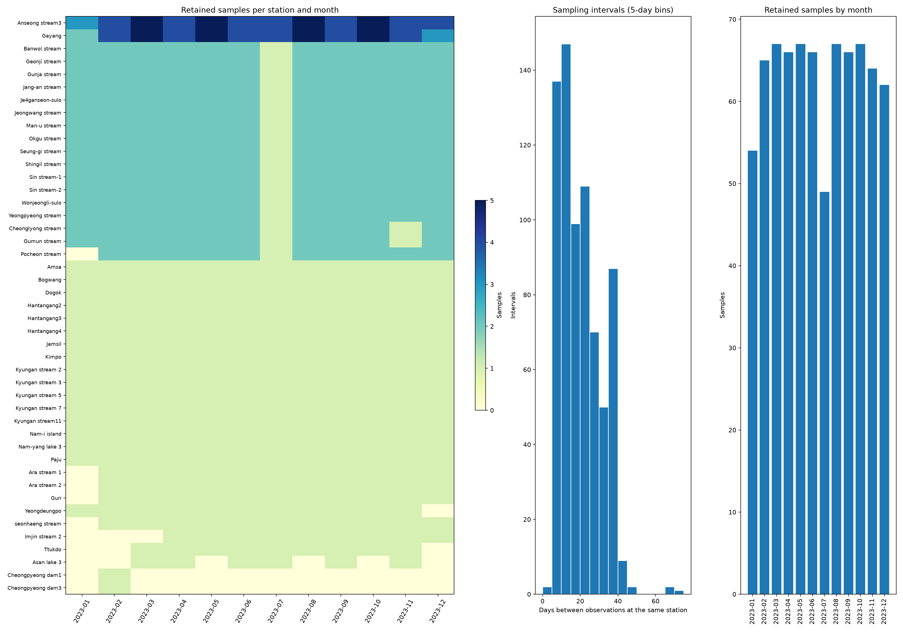

# Phân bố thời gian lấy mẫu và định hướng theo dõi chất lượng nước theo trạm

Ngày phân tích: 2026-09-29. Phạm vi: dữ liệu đã xử lý trong `data/processed/samples.parquet`.

## 1. Kết luận chính

**Dữ liệu có cấu trúc theo dõi lặp lại theo trạm, bao phủ khá đầy đủ các tháng, nhưng không được lấy mẫu cách đều theo ngày và không có cùng tần suất giữa các trạm.** Hướng nghiên cứu hiện tại được xác định là **theo dõi chất lượng nước của từng trạm theo thời gian**, ưu tiên đánh giá giá trị bổ sung của EEM trong ước lượng COD/TOC tại mỗi lần quan trắc.

Có 760 mẫu tại 45 trạm, từ 02/01/2023 đến 26/12/2023, trên 135 ngày lấy mẫu khác nhau. Toàn bộ dữ liệu thuộc năm 2023. Có 34/45 trạm (75,6%) đủ 12 tháng; 500/540 ô trạm–tháng có dữ liệu (92,6%). Hai trạm chỉ có một mẫu nên chưa thể phân tích biến động theo thời gian.

Không nên coi 760 mẫu là một chuỗi thời gian duy nhất hoặc xây 45 mô hình độc lập. Dữ liệu phù hợp hơn với một mô hình chung học từ nhiều trạm, có xét mức nền từng trạm, rồi đánh giá khả năng theo dõi từng trạm ở các thời điểm về sau.

## 2. Phạm vi và cách kiểm tra

- Dùng `Point` làm mã nhóm trạm; dùng `Sampling date` làm ngày quan trắc thực tế, không dùng `Round` để suy ra khoảng thời gian.
- Đếm mẫu theo trạm và tháng lịch; tính khoảng cách ngày giữa hai lần lấy mẫu liên tiếp **trong cùng trạm**.
- Cả 760 ngày và giờ đều đọc được. Không có sai khác giữa năm/tháng trong ngày thực tế và các cột `Year`, `Month`; không có hai dòng cùng trạm, cùng ngày.
- Khoảng cách chỉ được tính giữa các ngày quan sát được. Không suy ra khoảng cách trước mẫu đầu hoặc sau mẫu cuối; trạm một mẫu không có thống kê khoảng cách.
- “Tháng thiếu” nghĩa là không có mẫu trong **tập đã xử lý**, không chứng minh ngoài thực địa không lấy mẫu. `processing_summary.json` ghi 239 file không ghép được và 2 mẫu bị loại theo độ sâu. Cần kiểm tra dữ liệu nguồn trước khi quy kết nguyên nhân thiếu.

## 3. Tần suất và mức độ đều của từng trạm

Số mẫu/trạm có trung vị 12, khoảng tứ phân vị 12–23 và phạm vi 1–51. Có ba nhóm tần suất quan sát được; đây là mô tả dữ liệu, không phải lịch lấy mẫu được xác nhận từ quy trình thực địa.

| Nhóm quan sát | Số trạm | Đặc điểm |
| --- | --- | --- |
| Gần hằng tuần | 2 | Anseong stream3: 51 mẫu; Gayang: 49 mẫu. Cả hai đủ 12 tháng, median khoảng cách 7 ngày; khoảng cách lần lượt 5–14 và 4–14 ngày. |
| Khoảng hai lần/tháng | 17 | 21–23 mẫu/trạm; median khoảng cách 14–16 ngày. 16 trạm đủ 12 tháng; Pocheon stream thiếu tháng 1. |
| Tối đa một lần/tháng | 26 | 16 trạm đủ 12 tháng; 5 trạm có 11 tháng; 2 trạm có 9 tháng; Asan lake 3 có 6 tháng; 2 trạm chỉ có 1 tháng. |

**Đủ 12 tháng không đồng nghĩa cách đều 30 ngày.** Ví dụ Hantangang2/3/4 đều có một mẫu mỗi tháng nhưng khoảng cách dao động 13–43 ngày. Nam-i island cũng đủ 12 tháng nhưng có khoảng cách 45 ngày. Vì vậy, phân tích độ trễ cần dùng ngày thực tế hoặc lưới tháng có ghi nhận rõ ô thiếu.

Trên 715 khoảng cách liên tiếp của toàn bộ các trạm:

| Khoảng cách | Số khoảng | Tỷ lệ |
| --- | ---: | ---: |
| 1–10 ngày | 143 | 20,0% |
| 11–20 ngày | 263 | 36,8% |
| 21–40 ngày | 295 | 41,3% |
| Trên 40 ngày | 14 | 2,0% |

Khoảng cách nhỏ nhất 4 ngày; Q1 = 13, median = 16, Q3 = 28; phân vị 95% = 36 ngày; lớn nhất 72 ngày. Các tỷ lệ có làm tròn. Đây là phân bố gộp, chịu ảnh hưởng nhiều hơn từ các trạm lấy mẫu dày; median 16 ngày không phải nhịp đại diện của mọi trạm.

Asan lake 3 có các khoảng trống 68, 68 và 72 ngày, đồng thời thiếu 6 tháng. Cheongpyeong dam1 và Cheongpyeong dam3 chỉ có mẫu ngày 13/02/2023. Ba trạm này cần được báo cáo riêng khi đánh giá theo dõi thời gian.

## 4. Phân bố theo tháng và trong ngày

| Tháng 2023 | Số mẫu | Số trạm | Số ngày lấy mẫu |
| --- | --- | --- | --- |
| 01 | 54 | 35 | 8 |
| 02 | 65 | 42 | 11 |
| 03 | 67 | 42 | 12 |
| 04 | 66 | 43 | 12 |
| 05 | 67 | 42 | 13 |
| 06 | 66 | 43 | 11 |
| 07 | 49 | 43 | 10 |
| 08 | 67 | 42 | 12 |
| 09 | 66 | 43 | 11 |
| 10 | 67 | 42 | 12 |
| 11 | 64 | 43 | 13 |
| 12 | 62 | 40 | 10 |

Tháng 7 có ít mẫu nhất (49), nhưng vẫn có 43 trạm, bằng các tháng 4, 6, 9 và 11. Đối chiếu tháng 6–7 cho thấy **17 trạm thuộc nhóm khoảng hai lần/tháng đều giảm từ 2 xuống 1 mẫu**, giải thích mức giảm ròng từ 66 xuống 49 mẫu. Không có cơ sở từ bảng này để kết luận nguyên nhân là mùa mưa, vận hành hoặc thiếu ghép nối.

Tháng 1 chỉ có 35 trạm; tháng 12 có 40 trạm. Thành phần trạm và số lần lấy mẫu thay đổi khiến trung bình theo tất cả các dòng có thể thay đổi ngay cả khi mức nước tại từng trạm không đổi. Khi mô tả xu hướng toàn mạng, nên so sánh trung bình có trọng số bằng nhau giữa các trạm và phân tích nhạy cảm trên 34 trạm đủ 12 tháng.

Trong tháng, số mẫu ở ngày 1–10, 11–20 và 21–31 lần lượt là 267 (35,1%), 279 (36,7%) và 214 (28,2%). Đây là số đếm theo ba đoạn lịch có độ dài không hoàn toàn bằng nhau, không phải mật độ đã chuẩn hóa theo ngày.

Giờ lấy mẫu nằm trong khoảng **09:38–16:20**, với 697/760 mẫu (91,7%) từ 10:00 đến trước 14:00. Dữ liệu chủ yếu phản ánh quan trắc ban ngày, chưa mô tả được dao động cả ngày đêm. Không nên diễn giải một mẫu hàng tháng là trung bình liên tục của cả tháng.



## 5. Nhận xét về khả năng theo dõi chất lượng nước

**Điểm mạnh.** Có nhiều trạm được quan trắc lặp lại xuyên năm; phần lớn trạm có 11–12 tháng. Ngày quan trắc rõ ràng, không có trùng trạm–ngày trong dữ liệu đã xử lý. Có thể nghiên cứu mức nền từng trạm và sự thay đổi giữa những lần quan trắc.

**Giới hạn.** Chỉ có một năm nên chưa xác nhận được tính lặp lại của mùa vụ giữa các năm hoặc xu hướng dài hạn. Tần suất tháng/hai lần mỗi tháng không đủ để mô tả đầy đủ sự kiện ô nhiễm ngắn ngày. Hai trạm lấy mẫu gần hằng tuần cũng chỉ có 49–51 điểm, không đại diện cho cả mạng.

Phần lớn mẫu ở độ sâu 0,5 m (756/760); hai mẫu thiếu độ sâu, một mẫu 0 m và một mẫu 1 m. Phạm vi kết luận chủ yếu là lớp nước được lấy mẫu, không phải toàn bộ cột nước. Ngoài ra, dữ liệu đã được chọn theo khả năng ghép EEM–phòng thí nghiệm và yêu cầu đủ BOD/COD/TOC/SS/EC; lịch hiện tại có thể khác lịch quan trắc gốc.

## 6. Định hướng nghiên cứu hiện tại

### 6.1. Mục tiêu và câu hỏi nghiên cứu

**Mục tiêu: theo dõi chất lượng nước của từng trạm theo thời gian bằng EEM kết hợp thông tin quan trắc và lịch sử trạm.** Đơn vị phân tích chính là một lần quan trắc tại một trạm, với COD/TOC làm chỉ tiêu ưu tiên và BOD làm chỉ tiêu bổ sung.

Câu hỏi trọng tâm: khi đã biết mức nền và lịch sử của trạm, EEM của mẫu hiện tại có giúp ước lượng chất lượng nước và nhận biết thay đổi tốt hơn chỉ dùng lịch sử không?

Đầu ra đề xuất là đồ thị theo ngày của từng trạm, thể hiện giá trị xét nghiệm, giá trị ước lượng, mức nền lịch sử và sai số. Chỉ đánh dấu bất thường khi tiêu chí và độ tin cậy đã được kiểm chứng; dữ liệu hiện tại chưa có nhãn sự kiện để tuyên bố năng lực cảnh báo.

### 6.2. Phân biệt theo dõi hiện tại và dự báo tương lai

| Bài toán | Thông tin đầu vào | Vai trò |
| --- | --- | --- |
| Ước lượng tại lần quan trắc hiện tại | EEM hiện tại, biến đồng thời có sẵn, lịch sử trước đó | Hướng chính: hỗ trợ theo dõi từng trạm |
| Dự báo tháng/lần quan trắc tiếp theo | Chỉ thông tin đã có trước thời điểm dự báo | Hướng phụ: kiểm tra giá trị của lịch sử và EEM quá khứ |

Có EEM tháng đang được ước lượng không đồng nghĩa dự báo tháng đó trước khi lấy mẫu. LOMO là kiểm tra tháng được giữ lại; do có thể dùng các tháng phía sau để train, chưa thay thế được kiểm chứng theo thứ tự thời gian.

### 6.3. Thiết kế mô hình và đối chứng

Dùng mô hình chung cho nhiều trạm, có xét mức nền trạm; có thể thử mô hình phân cấp hoặc hồi quy phần chênh lệch so với mức nền. Đây là đề xuất cần đánh giá, chưa phải mô hình đã chứng minh tốt hơn.

So sánh trên cùng các mẫu test:

1. Trung bình lịch sử của trạm và giá trị quan trắc gần nhất; trạm chưa có lịch sử dùng baseline toàn bộ tập train và được báo cáo riêng.
2. Mô hình chỉ dùng lịch sử, gồm giá trị trước đó và số ngày kể từ lần quan trắc trước.
3. Mô hình chỉ dùng EEM và mô hình kết hợp lịch sử + EEM.
4. Bổ sung pH, EC, nhiệt độ hoặc các biến khác khi xác nhận chúng có sẵn lúc sử dụng; không đưa xét nghiệm cần dự đoán vào đầu vào.

Mức nền, phép biến đổi EEM và tham số mô hình chỉ được học từ dữ liệu huấn luyện. Với đặc trưng lịch sử của từng dòng huấn luyện, chỉ dùng các quan sát xảy ra trước dòng đó. Không lấy trung bình cả năm của trạm làm đặc trưng cho các thời điểm trước đó.

### 6.4. Kiểm chứng phù hợp với mục tiêu theo dõi

- Chia theo **tháng lịch trên toàn bộ mạng trạm**: train tháng 1–6, test tháng 7; mở rộng train đến tháng 7, test tháng 8; tiếp tục đến tháng 12. Không chia ngẫu nhiên các dòng để đánh giá khả năng sử dụng về sau.
- Ở mỗi lần đánh giá, cố định mô hình và lịch sử tại thời điểm kết thúc train nếu mục tiêu là đánh giá cả tháng tiếp theo. Nếu cập nhật sau mỗi lần quan trắc, phải mô tả một giao thức riêng và bảo đảm chỉ cập nhật từ thông tin đã có.
- Lựa chọn đặc trưng/tham số trong các mốc thời gian bên trong tập train; không chọn mô hình theo kết quả tháng test. Do các tháng đã được xem trong phân tích thăm dò, kết quả là kiểm chứng hồi cứu; cần dữ liệu mới để xác nhận độc lập.
- Báo cáo MAE/RMSE chung, MAE trung bình với trọng số bằng nhau giữa các trạm, kết quả từng trạm/từng tháng và mức giảm sai số so với baseline lịch sử. R² trên trạm có ít điểm hoặc biến động nhỏ chỉ là thông tin bổ sung.
- Phân tầng theo nhịp lấy mẫu và số ngày từ lần quan trắc trước; trạm một mẫu không được dùng để kết luận về khả năng theo dõi biến động.
- LOSO/two-way giữ vai trò đánh giá khả năng mở rộng sang trạm mới, không phải tiêu chí chính của mục tiêu theo dõi các trạm đã có lịch sử.

### 6.5. Xử lý dữ liệu theo tháng

Giữ dữ liệu theo ngày cho hướng ước lượng tại lần quan trắc. Khi làm dự báo tháng tiếp theo, có thể tạo bảng trạm–tháng gồm 500 ô quan sát được; lưu cả số mẫu và mức phân tán trong ô. Trung bình một ô chỉ là trung bình các mẫu quan sát được, không mặc nhiên là giá trị trung bình thực của cả tháng.

Tạo đủ lưới tháng trước khi tính lag: nếu thiếu tháng 5, mẫu tháng 4 không được gọi là lag một tháng của tháng 6. Có thể dùng giá trị gần nhất kèm độ cũ của quan sát. Không nội suy nhãn test hoặc dùng điểm tương lai để lấp khoảng trống. Phân tích trên 34 trạm đầy đủ nên là kiểm tra nhạy cảm, không thay thế toàn bộ dữ liệu và che khuất các trạm thiếu.

## 7. Các bước tiếp theo

1. Rà soát dữ liệu nguồn và ghép nối ở các trạm thiếu tháng, đặc biệt Asan lake 3 và hai trạm Cheongpyeong; xác định lịch thiếu do thu thập hay xử lý.
2. Dựng đồ thị COD/TOC/BOD theo ngày cho từng trạm, giữ dấu các khoảng trống và phân biệt điểm xét nghiệm với ước lượng.
3. Thực hiện đối chứng lịch sử, EEM và lịch sử + EEM theo giao thức thời gian ở trên; ưu tiên kiểm tra EEM có giảm sai số và theo sát biến động trong từng trạm không.
4. Mở rộng sang dự báo bước tiếp theo nếu có cải thiện ổn định so với baseline; thu thập thêm năm quan trắc để kiểm chứng mùa vụ và tính ổn định giữa các năm.

## 8. Phụ lục: toàn bộ 45 trạm

Tên trạm giữ nguyên theo cột `Point`. Dấu “—” nghĩa là không có đủ hai ngày để tính khoảng cách. Tháng thiếu được xét trong toàn bộ tháng 1–12/2023, không phải kết luận vi phạm lịch quan trắc dự kiến.

| Trạm | Mẫu | Tháng có mẫu | Tháng thiếu trong 2023 | Khoảng cách min / median / max (ngày) |
| --- | --- | --- | --- | --- |
| Anseong stream3 | 51 | 12 | Không | 5 / 7 / 14 |
| Gayang | 49 | 12 | Không | 4 / 7 / 14 |
| Banwol stream | 23 | 12 | Không | 6 / 15 / 29 |
| Geonji stream | 23 | 12 | Không | 6 / 15 / 29 |
| Gunja stream | 23 | 12 | Không | 7 / 14 / 29 |
| Jang-an stream | 23 | 12 | Không | 6 / 15 / 29 |
| Je4ganseon-sulo | 23 | 12 | Không | 7 / 14 / 29 |
| Jeongwang stream | 23 | 12 | Không | 7 / 14 / 29 |
| Man-u stream | 23 | 12 | Không | 7 / 14 / 29 |
| Okgu stream | 23 | 12 | Không | 7 / 14 / 29 |
| Seung-gi stream | 23 | 12 | Không | 7 / 14 / 29 |
| Shingil stream | 23 | 12 | Không | 7 / 14 / 29 |
| Sin stream-1 | 23 | 12 | Không | 8 / 14.5 / 29 |
| Sin stream-2 | 23 | 12 | Không | 8 / 14.5 / 29 |
| Wonjeongli-sulo | 23 | 12 | Không | 5 / 15.5 / 29 |
| Yeongpyeong stream | 23 | 12 | Không | 8 / 14.5 / 29 |
| Cheonglyong stream | 22 | 12 | Không | 6 / 15 / 35 |
| Gumun stream | 22 | 12 | Không | 6 / 16 / 29 |
| Pocheon stream | 21 | 11 | 01 | 8 / 14.5 / 29 |
| Amsa | 12 | 12 | Không | 12 / 35 / 37 |
| Bogwang | 12 | 12 | Không | 12 / 34 / 37 |
| Dogok | 12 | 12 | Không | 12 / 35 / 37 |
| Hantangang2 | 12 | 12 | Không | 13 / 29 / 43 |
| Hantangang3 | 12 | 12 | Không | 13 / 29 / 43 |
| Hantangang4 | 12 | 12 | Không | 13 / 29 / 43 |
| Jamsil | 12 | 12 | Không | 12 / 35 / 37 |
| Kimpo | 12 | 12 | Không | 12 / 34 / 37 |
| Kyungan stream 2 | 12 | 12 | Không | 16 / 33 / 36 |
| Kyungan stream 3 | 12 | 12 | Không | 16 / 33 / 36 |
| Kyungan stream 5 | 12 | 12 | Không | 16 / 33 / 36 |
| Kyungan stream 7 | 12 | 12 | Không | 16 / 33 / 36 |
| Kyungan stream11 | 12 | 12 | Không | 16 / 33 / 36 |
| Nam-i island | 12 | 12 | Không | 12 / 35 / 45 |
| Nam-yang lake 3 | 12 | 12 | Không | 21 / 34 / 36 |
| Paju | 12 | 12 | Không | 21 / 35 / 38 |
| Ara stream 1 | 11 | 11 | 01 | 21 / 32 / 37 |
| Ara stream 2 | 11 | 11 | 01 | 20 / 32 / 36 |
| Guri | 11 | 11 | 01 | 12 / 34 / 37 |
| Yeongdeungpo | 11 | 11 | 12 | 12 / 34 / 37 |
| seonhaeng stream | 11 | 11 | 01 | 10 / 28.5 / 47 |
| Imjin stream 2 | 9 | 9 | 01, 02, 03 | 13 / 31 / 42 |
| Ttukdo | 9 | 9 | 01, 02, 12 | 12 / 34 / 37 |
| Asan lake 3 | 6 | 6 | 01, 02, 05, 08, 10, 12 | 23 / 68 / 72 |
| Cheongpyeong dam1 | 1 | 1 | 01, 03, 04, 05, 06, 07, 08, 09, 10, 11, 12 | — |
| Cheongpyeong dam3 | 1 | 1 | 01, 03, 04, 05, 06, 07, 08, 09, 10, 11, 12 | — |

## 9. Tái lập và bảng dữ liệu

Chạy từ thư mục gốc dự án, với môi trường có pandas, pyarrow và matplotlib:

```bash
MPLCONFIGDIR=/tmp/eem-matplotlib .venv/bin/python scripts/diagnostics/analyze_sampling_calendar.py
```

Script tạo thống kê và hình; phần nhận xét và định hướng trong báo cáo này được viết từ các kết quả đó.

- [Thống kê từng trạm](assets/sampling_calendar/station_summary.csv)
- [Số mẫu từng trạm–tháng](assets/sampling_calendar/station_month_counts.csv)
- [Tất cả khoảng cách giữa các lần lấy mẫu](assets/sampling_calendar/sampling_gaps.csv)
- [Thống kê từng tháng](assets/sampling_calendar/monthly_summary.csv)
- [Phân bố giờ lấy mẫu](assets/sampling_calendar/sampling_hours.csv)
- [Thống kê tổng hợp dạng JSON](assets/sampling_calendar/summary.json)

Phân tích này không huấn luyện lại mô hình hoặc xác nhận lại các điểm số trong những báo cáo trước.
