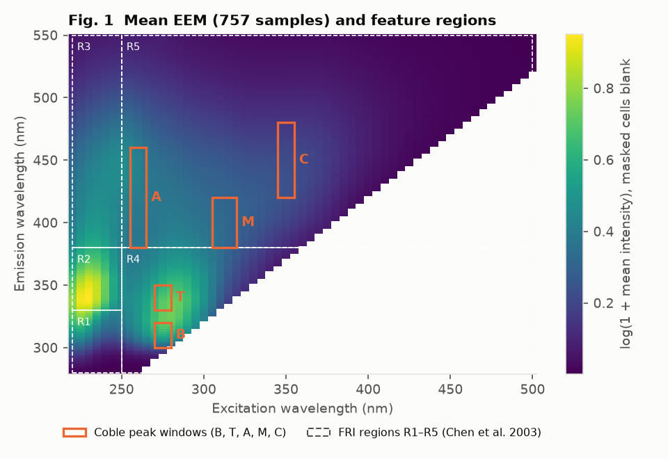
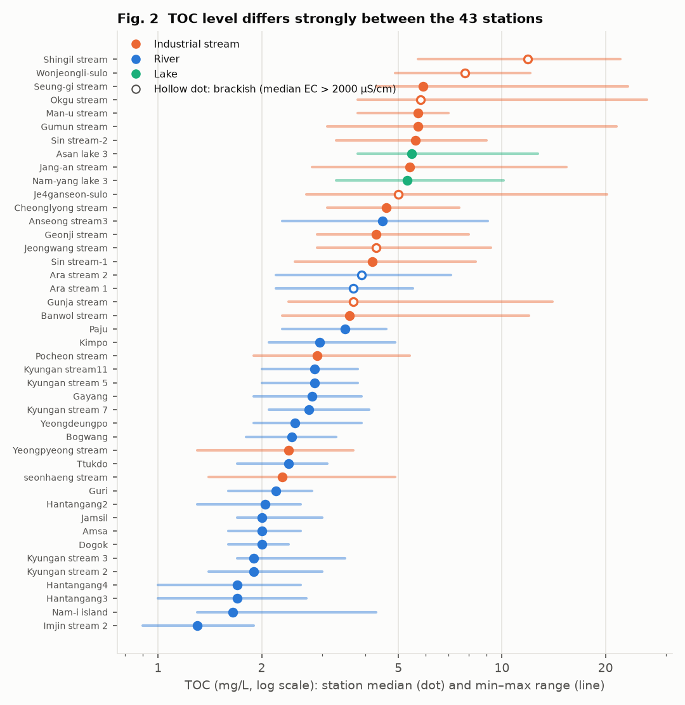
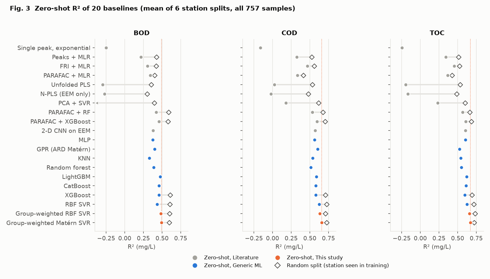
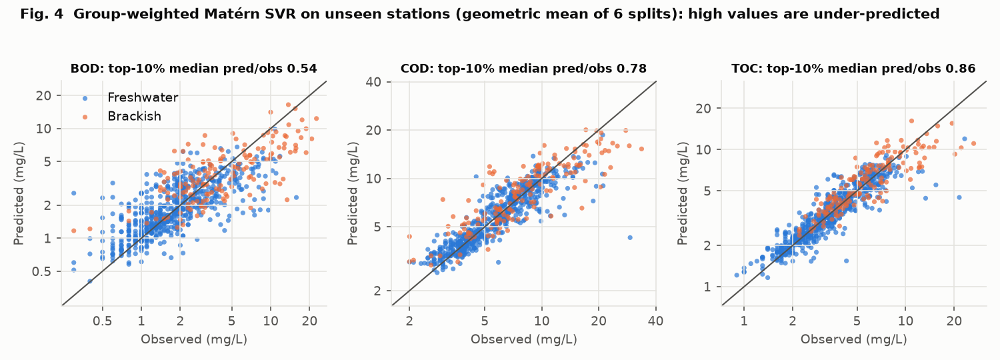
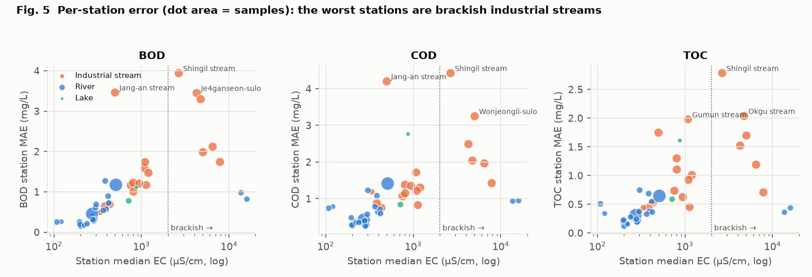
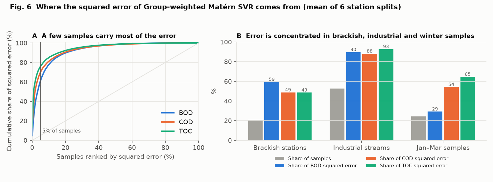
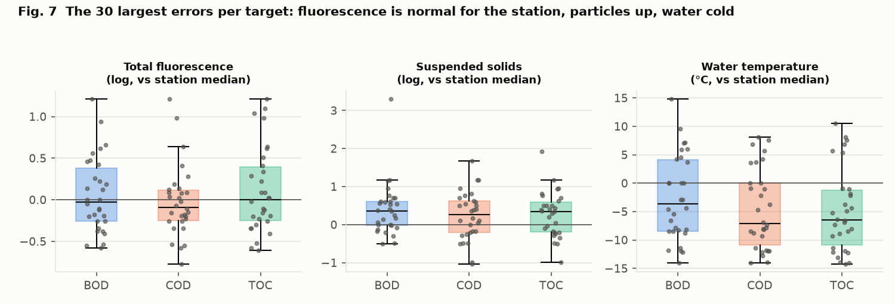
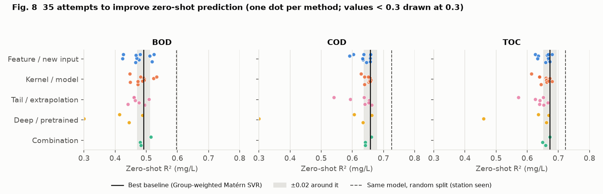
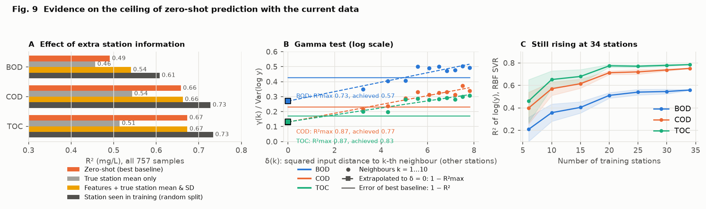
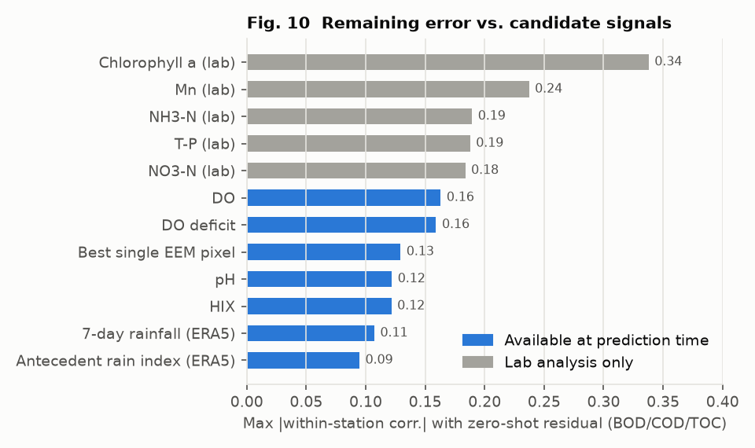

# Dự đoán BOD, COD và TOC từ phổ huỳnh quang EEM tại trạm quan trắc mới: tổng quan tài liệu, đánh giá baseline và giới hạn của dữ liệu

*Ngày 22/10/2026*

> **Cập nhật 28/10/2026.** Sau báo cáo này, mô hình `lgbm_oxy` (LightGBM với đặc trưng thiếu hụt oxy) đã được
> đưa vào pipeline. Với BOD, mô hình này đạt R² 0.54 trung bình qua 6 cách chia theo trạm, so với 0.49 của
> Group-weighted Matérn SVR. Station-MAE giảm 0.076 mg/L, KTC 95% [0.027; 0.127]. Với COD và TOC, kết quả
> không đổi. Các nhận định về BOD bên dưới ("tăng tối đa khoảng 0.03–0.04") phản ánh thời điểm 22/10.
> Kết quả hiện hành nằm trong README của repo.

## Tóm tắt

- **Bài toán.** Ước lượng ba chỉ tiêu chất hữu cơ BOD, COD và TOC (mg/L) của một mẫu nước từ phổ huỳnh quang kích thích–phát xạ (EEM) và 5 thông số đo tại hiện trường. Mô hình phải dùng được ở **trạm chưa có trong dữ liệu huấn luyện**.
- **Dữ liệu.** 757 mẫu nước mặt từ 43 trạm ở vùng Seoul–Gyeonggi (Hàn Quốc), lấy trong năm 2023.
- **Tổng quan tài liệu.** Đa số nghiên cứu đã công bố dùng dữ liệu một địa điểm hoặc chia mẫu ngẫu nhiên. Cách chia này cho phép mô hình "thấy" chính trạm cần dự đoán. Chỉ một nghiên cứu gần đây kiểm tra mô hình trên loại nước chưa thấy. R² của nó giảm từ 0.96 xuống 0.60 với nước sông [21].
- **Kết quả.** Nghiên cứu này đánh giá 20 baseline theo cùng một giao thức chia theo trạm. Baseline tốt nhất là Group-weighted Matérn SVR, đạt R² **0.49 / 0.66 / 0.67** (BOD / COD / TOC). Khi trạm có sẵn 3 mẫu đã đo gần nhất, R² tăng lên **0.58 / 0.76 / 0.74**.
- **Sai số tập trung ở đâu.** 5% số mẫu gây ra 61–76% tổng bình phương sai số. Các mẫu này phần lớn thuộc **suối công nghiệp, đặc biệt là suối nước lợ**, và thường lấy vào **mùa lạnh (tháng 1–3)**. Ở các mẫu sai số lớn nhất, huỳnh quang không tăng so với mức thường của trạm, trong khi nồng độ đo được tăng mạnh.
- **Khả năng phát triển mô hình tốt hơn.** 35 phương pháp cải tiến đã được thử. Không phương pháp nào tăng R² COD hoặc TOC quá 0.02 so với baseline tốt nhất; BOD tăng tối đa khoảng 0.03–0.04. Ba phép kiểm tra không phụ thuộc mô hình cho cùng một kết luận:
  1. cho mô hình biết trước mức trung bình thật của trạm gần như không giúp ích;
  2. phần sai số còn lại không học được từ bất kỳ tín hiệu nào có sẵn khi dự đoán;
  3. với COD và TOC, cận trên ước lượng bằng Gamma test đã gần đạt.
- **Kết luận.** Với dữ liệu hiện có, một mô hình mới khó cải thiện đáng kể COD và TOC. BOD còn một khoảng trống nhỏ. Hướng có triển vọng là **bổ sung thông tin**: thêm trạm, thêm phổ hấp thụ hoặc độ đục, mở rộng dải phát xạ. Thay đổi kiến trúc mô hình ít có khả năng giúp ích.

---

## 1. Bài toán

### 1.1. Bối cảnh

BOD (nhu cầu oxy sinh hóa), COD (nhu cầu oxy hóa học) và TOC (tổng cacbon hữu cơ) là ba chỉ tiêu phổ biến để đánh giá mức ô nhiễm hữu cơ của nước. Chúng tốn thời gian hoặc chi phí để đo:
- **BOD₅** cần ủ mẫu 5 ngày;
- **COD** cần phân hủy mẫu bằng hóa chất oxy hóa mạnh;
- **TOC** cần máy phân tích cacbon chuyên dụng.

Phổ EEM đo được trong vài phút, gần như không cần hóa chất. Phép đo chiếu ánh sáng ở nhiều bước sóng kích thích (Ex), rồi ghi cường độ huỳnh quang ở nhiều bước sóng phát xạ (Em). Kết quả là một ma trận cường độ $F(\lambda_{ex}, \lambda_{em})$ (Hình 1).

Một phần chất hữu cơ hòa tan phát huỳnh quang ở các vùng đặc trưng [1, 2]:
- vùng **giống protein** (đỉnh B, T): thường gắn với chất hữu cơ dễ phân hủy, nước thải;
- vùng **giống humic** (đỉnh A, C, M): chất hữu cơ có nguồn gốc đất và thực vật.

Vì vậy EEM đã được đề xuất làm phép đo thay thế ("surrogate") cho BOD, COD, TOC [3, 4]. Tuy nhiên có ba giới hạn đã biết:
- chất hữu cơ **không phát huỳnh quang** và chất hữu cơ **dạng hạt** không xuất hiện trong phổ, trong khi BOD, COD, TOC đo trên mẫu tổng (gồm cả phần hạt);
- cường độ huỳnh quang bị ảnh hưởng bởi hiệu ứng lọc trong (inner-filter), độ đục, pH và độ mặn [5, 6];
- quan hệ giữa huỳnh quang và nồng độ thay đổi theo nguồn nước [4, 7].

### 1.2. Phát biểu bài toán

Mỗi mẫu $i$ thuộc một trạm $s(i)$. Mẫu có:
- **đầu vào** $\mathbf{x}_i$: ma trận EEM $F_i$ và 5 thông số hiện trường (nhiệt độ, pH, oxy hòa tan DO, chất rắn lơ lửng SS, độ dẫn điện EC);
- **đầu ra** $y_i$ (mg/L) của một trong ba chỉ tiêu BOD, COD, TOC, đo ở phòng thí nghiệm.

Ta cần một hàm $f$ sao cho $\hat y = f(\mathbf{x})$ gần $y$. Báo cáo xét hai kịch bản sử dụng:

| Kịch bản | Thông tin về trạm cần dự đoán khi huấn luyện | Ý nghĩa thực tế |
|---|---|---|
| **Zero-shot** | Không có mẫu nào của trạm đó | Lắp thiết bị ở trạm mới, chưa có số liệu phòng thí nghiệm |
| **Few-shot (K = 3)** | Có K mẫu của trạm đã có kết quả phòng thí nghiệm | Trạm gửi định kỳ một số ít mẫu đi phân tích để hiệu chỉnh |

**Câu hỏi nghiên cứu.**
- (Q1) Các mô hình trong tài liệu và các mô hình học máy mạnh đạt độ chính xác bao nhiêu khi trạm chưa được thấy?
- (Q2) Sai số tập trung ở loại trạm và loại mẫu nào? Vì sao?
- (Q3) Có cơ sở để kỳ vọng một mô hình mới tốt hơn đáng kể trên dữ liệu này không?

---

## 2. Tổng quan tài liệu

### 2.1. Các nghiên cứu dự đoán chỉ tiêu hữu cơ từ huỳnh quang

**Bảng 1.** Các nghiên cứu tiêu biểu. Kết quả là số do tác giả báo cáo. Chúng **không so sánh trực tiếp được** với nhau hoặc với nghiên cứu này, vì khác chỉ tiêu, loại nước và cách đánh giá.

| Nghiên cứu | Dữ liệu | Đầu vào | Mô hình | Cách đánh giá | Kết quả báo cáo |
|---|---|---|---|---|---|
| Bieroza và cs. 2011 [8] | Nhà máy nước uống, Anh | EEM, PARAFAC | MLR, PLS, mạng nơ-ron | Trong cùng hệ thống | Dự đoán TOC và hiệu quả xử lý |
| Hur & Cho 2012 [9] | Một sông đô thị, Hàn Quốc | PARAFAC, hấp thụ UV | Hồi quy | Một sông | Tương quan tốt với BOD, COD |
| Yang, Shin & Hur 2014 [10] | 22 nhà máy xử lý nước thải, Hàn Quốc | PARAFAC, SS | Hồi quy đa biến | Gộp mẫu | Thêm SS cải thiện dự đoán BOD, COD, TOC |
| Christian và cs. 2017 [11] | Một cơ sở xử lý nước thải | COD, TOC, huỳnh quang | Hồi quy tuyến tính và mũ | Một cơ sở | BOD₅ từ huỳnh quang hoặc TOC, r > 0.95 |
| Dai và cs. 2022 [12] | >600 mẫu, 60 sông, Trung Quốc | Đỉnh, chỉ số, FRI của EEM, chỉ số hấp thụ | ε-SVR | Chia tập huấn luyện/kiểm tra (chưa xác nhận chia theo vị trí) | BOD₅, COD và dinh dưỡng |
| Peer và cs. 2022 [13] | 7 sự kiện lũ, một sông ở Áo | EEM | PARAFAC, PLS, sparse PLS | Trong cùng sông | DOC (RMSE 0.41 mg/L), chloride |
| Zhang và cs. 2025 [14] | Mẫu đo lặp trong 5 ngày ủ | PARAFAC + thời gian ủ | Random forest | Chia mẫu | BOD₅, R² 0.88 |
| de Paulo và cs. 2026 [15] | Nước thải | EEM, UV-Vis | PLS, unfolded PLS, SVR | Tập dự đoán riêng | BOD R² 0.85 (UPLS); COD R² 0.74 (SVR) |
| Peleato và cs. 2018 [16]; Peleato 2022 [17] | Nước cấp | EEM | Autoencoder + mạng nơ-ron; CNN | Chia mẫu | Sản phẩm phụ khử trùng |
| Weiser và cs. 2024 [18] | Cửa sông và đất ngập nước ven biển | Huỳnh quang FDOM tại chỗ + biến chất lượng nước | Hiệu chỉnh theo biến phụ trợ | Nhiều hệ sinh thái | DOC; quan hệ huỳnh quang–DOC cần hiệu chỉnh theo điều kiện nước |
| Yang và cs. 2026 [21] | 508 mẫu, 4 loại nước (nhà máy, cống, sông, biển), Thâm Quyến | PARAFAC (EEM), PCA (UV-Vis) | 8 thuật toán; XGBoost tốt nhất | Gộp; **bỏ cả một loại nước (LOMO)**; theo thời gian | DOC: gộp 0.96; LOMO sông **0.60**; theo thời gian sông 0.53 |

**Nhận xét từ Bảng 1.**
1. **Họ mô hình đã được thử rộng.** Hồi quy tuyến tính, PLS, PARAFAC, SVR, random forest, XGBoost, mạng nơ-ron, CNN và autoencoder đều đã có trong tài liệu. Áp dụng một thuật toán quen thuộc vào EEM vì vậy không tự tạo ra tính mới.
2. **Cách đánh giá thường lạc quan.** Phần lớn nghiên cứu dùng một địa điểm hoặc chia mẫu ngẫu nhiên. Khi đó các mẫu cùng trạm, cùng đợt có mặt ở cả tập huấn luyện và tập kiểm tra. Trong dữ liệu không gian, điều này làm hiệu năng bị đánh giá quá cao [19, 20].
3. **Rất ít nghiên cứu kiểm tra khả năng chuyển giao.** Nghiên cứu gần nhất là Yang và cs. 2026 [21]. R² của nước sông giảm rõ khi loại nước đó không có trong tập huấn luyện. Tài liệu về cảm biến huỳnh quang cũng khuyến nghị hiệu chỉnh riêng cho từng vị trí [18, 22].

### 2.2. Học chuyển giao giữa các trạm quan trắc

Ba nghiên cứu về chất lượng nước (không dùng EEM) cho thấy ba cách khác nhau để dùng dữ liệu từ trạm khác:
- **Peng và cs. 2022** [23] chuyển trọng số Transformer từ 90 trạm nguồn sang 30 trạm đích. Mô hình được tinh chỉnh luân phiên giữa dữ liệu nguồn và đích, để dự báo chuỗi thời gian. Phương pháp cần lịch sử dài ở trạm đích.
- **Liao và cs. 2025** [24] chọn trạm nguồn theo độ tương đồng rồi tinh chỉnh mạng nơ-ron. Trạm đích vẫn cần hàng trăm mẫu có nhãn.
- **Yan và cs. 2025** [25] dùng 171 trạm, dự đoán TP từ biến môi trường. Khi trạm hoàn toàn mới, NSE chỉ đạt 0.20. Bổ sung 2% nhãn của trạm làm NSE tăng lên 0.78.

Cả ba nghiên cứu đều cho thấy: thông tin riêng của trạm là yếu tố quyết định, và mô hình chung cho nhiều trạm kém hơn mô hình riêng.

### 2.3. Khoảng trống và vị trí của nghiên cứu này

Chưa tìm thấy nghiên cứu nào đánh giá dự đoán **BOD, COD, TOC tổng** từ **EEM và thông số hiện trường** trên **trạm chưa thấy** của một mạng lưới nước mặt nhiều trạm. Cũng chưa thấy nghiên cứu nào phân tích **vì sao** độ chính xác dừng ở một mức nhất định.

Phần tra cứu dựa trên tìm kiếm có cấu trúc. Nó chưa phải tổng quan hệ thống theo PRISMA và chưa tra Scopus hay Web of Science. Một số nghiên cứu mới chỉ được đọc ở mức tóm tắt.

---

## 3. Dữ liệu

**Bảng 2.** Mô tả dữ liệu.

| Mục | Giá trị |
|---|---|
| Số mẫu, số trạm, thời gian | 757 mẫu, 43 trạm; 02/01/2023 – 26/12/2023 |
| Số mẫu mỗi trạm | 6–51, trung vị 12; khoảng cách giữa hai lần lấy mẫu liên tiếp có trung vị 16 ngày |
| Loại trạm (theo hồ sơ trạm) | Suối công nghiệp: 18 trạm, 398 mẫu. Sông: 23 trạm, 341 mẫu. Hồ: 2 trạm, 18 mẫu |
| Trạm nước lợ (trung vị EC > 2000 µS/cm) | 8 trạm, 160 mẫu (6 suối công nghiệp ven biển phía tây, 2 đoạn kênh Ara) |
| EEM | Ex 220–500 nm (bước 5 nm), Em 280–550 nm (dùng bước 2 nm). Vùng tán xạ Rayleigh bị che; còn 4 776 ô hợp lệ |
| Thông số hiện trường | Nhiệt độ, pH, DO, SS, EC |
| Nhãn: trung vị / phân vị 90% / max (mg/L) | BOD 2.0 / 6.9 / 22.6; COD 6.0 / 11.5 / 33.7; TOC 3.6 / 7.4 / 26.4 |

**Lưu ý về dữ liệu.**
- **Không có phổ hấp thụ** đi kèm EEM, nên không hiệu chỉnh được hiệu ứng lọc trong [6].
- Metadata **không ghi rõ phương pháp COD**. Dữ liệu có 14 mẫu có BOD > COD. Điều này phù hợp với COD theo permanganat (COD_Mn) hơn là COD theo dicromat.

**Rà soát dữ liệu gốc.**
- **Một lỗi đã được sửa.** File EEM của mẫu Gayang ngày 17/04/2023 trùng từng byte với file của trạm Man-u stream cùng ngày. Phổ khớp với Man-u, nên mẫu Man-u được giữ và mẫu Gayang bị loại.
- **Năm dòng nhãn bị gắn cờ** vì tỉ số COD/TOC bất thường: một dòng có tỉ số 10.1, một dòng 3.1, ba dòng có TOC > COD. Các dòng này được **giữ lại** trong mọi đánh giá.

*Hình 1. EEM trung bình của 757 mẫu. Khung cam là cửa sổ 5 đỉnh Coble [1]. Khung nét đứt là 5 vùng FRI [26]. Vùng trắng ở góc dưới phải bị che vì tán xạ.*

**Khác biệt giữa các trạm rất lớn.** Tính trên log nồng độ, **58% / 67% / 70%** phương sai của BOD / COD / TOC nằm ở mức trung bình của từng trạm (Hình 2). 7 trong 8 trạm có TOC trung vị cao nhất là suối công nghiệp.

*Hình 2. Trung vị (chấm) và khoảng min–max (đoạn thẳng) của TOC theo trạm. Màu thể hiện loại trạm; chấm rỗng là trạm nước lợ.*

---

## 4. Phương pháp

### 4.1. Đặc trưng

Ký hiệu $F(\lambda_{ex}, \lambda_{em})$ là cường độ huỳnh quang tại bước sóng kích thích $\lambda_{ex}$ và phát xạ $\lambda_{em}$ (nm), sau khi che vùng tán xạ.

**Bảng 3.** Các khối đặc trưng và nguồn gốc. Công thức ở cột thứ hai được viết đầy đủ ngay dưới bảng.

| Khối | Công thức | Nguồn |
|---|---|---|
| Đỉnh B, T, A, M, C | (1) | Coble 1996 [1] |
| HIX (chỉ số humic hóa) | (2) | Ohno 2002 [27] |
| BIX (chỉ số sinh học) | (3) | Huguet và cs. 2009 [28] |
| FI (chỉ số huỳnh quang) | (4) | McKnight và cs. 2001 [29]; Cory & McKnight 2005 [30] |
| FRI, 5 vùng | (5) | Chen và cs. 2003 [26] |
| PARAFAC, 4 thành phần | (6) | Bro 1997 [31]; Stedmon & Bro 2008 [32]. Thuật toán HALS [33]; ô bị che được nội suy theo [34] |
| Thông số hiện trường | Nhiệt độ, pH, DO, $\log(1+\mathrm{SS})$, $\log(1+\mathrm{EC})$ | — |
| Mùa | (7) | — |

**Đỉnh Coble.** Với cửa sổ $W_k$ của đỉnh $k$:

$$
P_k = \log\Bigl(1 + \max_{(\lambda_{ex},\lambda_{em}) \in W_k} F(\lambda_{ex}, \lambda_{em})\Bigr) \tag{1}
$$

Cửa sổ $W_k$ (Ex / Em, nm): B 270–280 / 300–320; T 270–280 / 330–350; A 255–265 / 380–460; M 305–320 / 380–420; C 345–355 / 420–480.

**Các chỉ số phổ.** Tổng $\sum$ lấy trên các ô hợp lệ trong khoảng ghi ở chỉ số dưới:

$$
\mathrm{HIX} = \frac{\sum_{\lambda_{ex}\in[250,255],\ \lambda_{em}\in[435,480]} F}{\sum_{\lambda_{ex}\in[250,255],\ \lambda_{em}\in[435,480]} F \;+\; \sum_{\lambda_{ex}\in[250,255],\ \lambda_{em}\in[300,345]} F} \tag{2}
$$

$$
\log \mathrm{BIX} = \log \frac{F(310,\,380)}{F(310,\,430)} \tag{3}
$$

$$
\log \mathrm{FI} = \log \frac{F(370,\,470)}{F(370,\,520)} \tag{4}
$$

**FRI.** Với $N$ là tổng số ô hợp lệ của EEM và $N_r$ là số ô của vùng $R_r$ ($r = 1,\dots,5$):

$$
\mathrm{FRI}_r = \log\Bigl(1 + \frac{N}{N_r} \sum_{(\lambda_{ex},\lambda_{em}) \in R_r} F(\lambda_{ex}, \lambda_{em})\Bigr) \tag{5}
$$

**PARAFAC.** EEM của mẫu $i$ được xấp xỉ bằng tổng của $R = 4$ thành phần không âm:

$$
F_i(\lambda_{ex}, \lambda_{em}) \approx \sum_{r=1}^{R} a_{ir}\, b_r(\lambda_{em})\, c_r(\lambda_{ex}), \qquad a_{ir},\, b_r,\, c_r \ge 0 \tag{6}
$$

Đặc trưng là $\log \mathrm{Fmax}_{ir} = \log\bigl(a_{ir} \cdot \max b_r \cdot \max c_r\bigr)$. Các phổ $b_r, c_r$ chỉ được khớp trên tập huấn luyện. Mẫu kiểm tra được chiếu lên các thành phần đã khớp bằng bình phương tối thiểu không âm để lấy $a_{ir}$.

**Mùa.** Với $d$ là ngày trong năm:

$$
s_1 = \sin\frac{2\pi d}{365.25}, \qquad s_2 = \cos\frac{2\pi d}{365.25} \tag{7}
$$

**Biến mục tiêu.** Các mô hình phi tuyến học $z = \log y$, rồi đổi lại $\hat y = \exp(\hat z)$. Các mô hình tuyến tính hóa học lượng (MLR, PLS, N-PLS) học trực tiếp trên mg/L như trong tài liệu gốc. Mọi dự đoán bị giới hạn trong khoảng $\bigl[\min y_{\text{train}} / 2,\; 2 \max y_{\text{train}}\bigr]$.

### 4.2. Mô hình

**Bảng 4.** Các baseline và nguồn của ý tưởng. "+ hiện trường" nghĩa là ghép thêm 5 thông số hiện trường vào đầu vào.

| Nhóm | Baseline | Đầu vào | Mô hình và siêu tham số | Nguồn ý tưởng |
|---|---|---|---|---|
| Theo tài liệu EEM | Một đỉnh, dạng mũ | 1 đỉnh Coble, chọn bằng CV | $\log y = a + b\,P_k$ | Christian và cs. 2017 [11] |
| | Peaks / FRI / PARAFAC + MLR | Khối tương ứng + hiện trường | Hồi quy tuyến tính, mg/L | Hur & Cho 2012 [9]; Yang 2014 [10] |
| | Unfolded PLS | Toàn bộ EEM duỗi phẳng + hiện trường | PLS1 (NIPALS), 1–15 thành phần | Wold 2001 [35]; de Paulo 2026 [15] |
| | N-PLS | Khối EEM 3 chiều | PLS ba chiều, 1–15 thành phần | Bro 1996 [36] |
| | PCA + SVR | 20 thành phần PCA của EEM + hiện trường | SVR RBF | Dai 2022 [12] |
| | PARAFAC + RF / XGBoost | PARAFAC + hiện trường | 500 cây | Zhang 2025 [14]; Yang 2026 [21] |
| | CNN 2 chiều | Ảnh $\log(1+F)$ + hiện trường | 3 khối tích chập 16/32/64 kênh, một mạng cho cả 3 chỉ tiêu, dừng sớm theo trạm | Peleato 2022 [17] |
| Học máy chung | MLP, GPR (ARD Matérn), KNN, RF, LightGBM, CatBoost, XGBoost, SVR RBF | Peaks + FRI + hiện trường + mùa (23 biến) | Siêu tham số chọn bằng CV theo trạm | [37–42] |
| **Nghiên cứu này** | Group-weighted RBF / Matérn SVR | 23 biến như trên | Công thức (8)–(10) | SVR [37], kernel Matérn [38], trọng số đặc trưng trong kernel [50], kết hợp kernel theo nhóm [45] |

**SVR.** Hàm dự đoán có dạng $f(\mathbf{x}) = \sum_i \alpha_i\, k(\mathbf{x}_i, \mathbf{x}) + b$. Mô hình được học bằng cách cực tiểu hàm mất mát $\varepsilon$-insensitive [37]:

$$
\min_{f}\; \frac{1}{2}\lVert \mathbf{w} \rVert^2 + C \sum_{i} \max\bigl(0,\; \lvert z_i - f(\mathbf{x}_i) \rvert - \varepsilon\bigr), \qquad \varepsilon = 0.1,\; C \in \{1, 3, 10\} \tag{8}
$$

**Group-weighted Matérn SVR** (SVR với trọng số theo nhóm đặc trưng). Các đặc trưng được chuẩn hóa rồi chia thành 4 nhóm $g$ có ý nghĩa: đỉnh và chỉ số, FRI, hiện trường, mùa. Mỗi nhóm có một trọng số $w_g$ điều chỉnh mức ảnh hưởng của nhóm đó lên khoảng cách giữa hai mẫu:

$$
r(\mathbf{x}, \mathbf{x}') = \bigl\lVert W(\mathbf{x} - \mathbf{x}') \bigr\rVert, \qquad W = \operatorname{diag}(w_g), \quad w_g \in \{0,\, 0.5,\, 1,\, 2\} \tag{9}
$$

Kernel Matérn-5/2 [38], với $d = 23$ là số đặc trưng:

$$
k(\mathbf{x}, \mathbf{x}') = \Bigl(1 + \frac{\sqrt{5}\, r}{\ell} + \frac{5 r^2}{3 \ell^2}\Bigr) \exp\Bigl(-\frac{\sqrt{5}\, r}{\ell}\Bigr), \qquad \ell = m\sqrt{d}, \quad m \in \{0.5,\, 1,\, 2\} \tag{10}
$$

Trọng số $w_g$, hệ số $m$ và $C$ được chọn bằng coordinate descent, cực tiểu MAE trên $\log y$ trong CV 3 fold chia theo trạm, **chỉ dùng các trạm huấn luyện**. $w_g = 0$ tương đương bỏ hẳn nhóm $g$.

**Nguồn ý tưởng.** Từng thành phần đều đã có:
- SVR [37];
- kernel Matérn [38];
- nhân mỗi đặc trưng với một hệ số tỉ lệ trong kernel của SVM, chọn để giảm sai số dự đoán [50];
- kết hợp nhiều kernel, mỗi kernel cho một nhóm đầu vào (multiple kernel learning) [45]. Vì $\exp(-\sum_g a_g) = \prod_g \exp(-a_g)$, kernel RBF có trọng số nhóm tương đương tích của các kernel con theo nhóm.

Cách đặt trọng số này tương tự ARD trong Gaussian process [43, 44], nhưng có hai điểm khác: trọng số đặt cho **nhóm** đặc trưng chứ không cho từng đặc trưng, và được chọn từ một lưới giá trị rời rạc bằng CV theo trạm chứ không bằng tối đa hóa likelihood. Phần của nghiên cứu này là cách ghép: nhóm đặc trưng theo ý nghĩa phổ học và chọn trọng số bằng CV theo trạm. Đây là một baseline mạnh, **không phải một thuật toán mới**.

### 4.3. Giao thức đánh giá

**Zero-shot.**
- Dùng **6 cách chia 5 fold theo trạm**: 1 cách chia cố định và 5 cách GroupKFold với seed khác nhau. Mỗi trạm chỉ nằm trong một fold.
- Mọi bước học (chuẩn hóa, PARAFAC, PCA, chọn siêu tham số) chỉ dùng các trạm huấn luyện.
- Kết quả chấm trên **cả 757 mẫu**, rồi lấy trung bình qua 6 cách chia.
- Chia mẫu ngẫu nhiên (5 fold) chỉ được báo cáo làm mốc tham chiếu.

**Few-shot ($K = 3$).** Gọi $\mathcal{S}_s$ là tập $K$ mẫu hỗ trợ (đã có nhãn) của trạm $s$. Dự đoán zero-shot của trạm được hiệu chỉnh bằng một độ lệch trên thang log, có co rút về 0:

$$
b_s = \frac{1}{K + \kappa} \sum_{j \in \mathcal{S}_s} \bigl(\log y_j - \log \hat y_j\bigr), \qquad \kappa = 3, \qquad \hat y_i' = \hat y_i \exp(b_s) \tag{11}
$$

Có hai thiết kế, cả hai đều chỉ dùng thông tin có trước thời điểm dự đoán:
- *early*: $\mathcal{S}_s$ là 3 mẫu đầu tiên của trạm;
- *rolling*: $\mathcal{S}_s$ là 3 mẫu có nhãn ngay trước mẫu cần dự đoán.

Kết quả chấm trên các mẫu không làm hỗ trợ, tức các mẫu từ thứ 4 trở đi của mỗi trạm (628 mẫu).

**Chỉ số.** Tất cả tính trên mg/L. Gọi $n$ là số mẫu, $S$ là số trạm và $n_s$ là số mẫu của trạm $s$.

$$
R^2 = 1 - \frac{\sum_{i=1}^{n} (y_i - \hat y_i)^2}{\sum_{i=1}^{n} (y_i - \bar y)^2} \tag{12}
$$

$$
\text{station-MAE} = \frac{1}{S} \sum_{s=1}^{S} \frac{1}{n_s} \sum_{i \in s} \lvert y_i - \hat y_i \rvert \tag{13}
$$

- $R^2$ tính gộp mọi mẫu, nên nhạy với các mẫu nồng độ cao.
- station-MAE cho mỗi trạm trọng số như nhau.
- MAE của 10% mẫu có nồng độ cao nhất đo riêng sai số ở phần đuôi.
- So sánh hai mô hình bằng chênh lệch station-MAE, với khoảng tin cậy 95% bootstrap theo trạm (2 000 lần).

---

## 5. Kết quả

### 5.1. Zero-shot

**Bảng 5.** Zero-shot, trung bình 6 cách chia theo trạm, 757 mẫu. Mỗi ô ghi R² / station-MAE / MAE của 10% mẫu cao nhất (mg/L). Cột cuối là R² khi chia mẫu ngẫu nhiên (chỉ có cho các mô hình trong pipeline chính).

| Baseline | BOD | COD | TOC | R² chia ngẫu nhiên (B / C / T) |
|---|---|---|---|---|
| Một đỉnh, dạng mũ | −0.25 / 1.55 / 8.26 | −0.16 / 2.02 / 9.55 | −0.25 / 1.40 / 6.27 | — |
| Peaks + MLR | 0.22 / 1.65 / 5.44 | 0.33 / 2.08 / 6.43 | 0.34 / 1.35 / 4.04 | 0.43 / 0.53 / 0.52 |
| FRI + MLR | 0.31 / 1.57 / 5.24 | 0.47 / 1.89 / 5.93 | 0.46 / 1.22 / 3.84 | 0.42 / 0.56 / 0.53 |
| PARAFAC + MLR | 0.34 / 1.54 / 5.15 | 0.33 / 2.18 / 6.38 | 0.37 / 1.40 / 4.01 | 0.40 / 0.41 / 0.43 |
| Unfolded PLS | −0.30 / 1.88 / 7.21 | 0.02 / 2.09 / 7.34 | −0.20 / 1.49 / 4.96 | 0.36 / 0.54 / 0.54 |
| N-PLS (chỉ EEM) | −0.27 / 1.89 / 7.44 | −0.02 / 2.21 / 7.76 | −0.17 / 1.55 / 5.04 | 0.30 / 0.48 / 0.49 |
| PCA + SVR | −0.44 / 1.56 / 7.00 | 0.18 / 1.80 / 7.23 | 0.23 / 1.15 / 4.32 | 0.40 / 0.62 / 0.60 |
| PARAFAC + RF | 0.42 / 1.08 / 5.78 | 0.54 / 1.36 / 5.86 | 0.57 / 0.87 / 3.54 | 0.59 / 0.68 / 0.67 |
| PARAFAC + XGBoost | 0.46 / 1.08 / 5.41 | 0.60 / 1.29 / 5.26 | 0.61 / 0.84 / 3.35 | 0.58 / 0.70 / 0.69 |
| CNN 2 chiều | 0.38 / 1.15 / 5.33 | 0.57 / 1.34 / 5.29 | 0.60 / 0.87 / 3.29 | — |
| MLP | 0.38 / 1.14 / 5.14 | 0.56 / 1.38 / 4.88 | 0.60 / 0.85 / 3.03 | — |
| GPR (ARD Matérn) | 0.40 / 1.14 / 5.58 | 0.61 / 1.28 / 4.89 | 0.52 / 0.87 / 3.45 | — |
| KNN | 0.33 / 1.15 / 6.06 | 0.54 / 1.34 / 6.07 | 0.54 / 0.90 / 3.82 | — |
| Random forest | 0.39 / 1.08 / 6.08 | 0.51 / 1.35 / 6.26 | 0.55 / 0.87 / 3.75 | — |
| LightGBM | 0.48 / 1.03 / 5.28 | 0.59 / 1.30 / 5.32 | 0.62 / 0.83 / 3.26 | — |
| CatBoost | 0.46 / 1.03 / 5.42 | 0.58 / 1.27 / 5.44 | 0.61 / 0.80 / 3.25 | — |
| XGBoost | 0.46 / 1.04 / 5.36 | 0.58 / 1.30 / 5.33 | 0.60 / 0.85 / 3.32 | 0.61 / 0.71 / 0.69 |
| SVR RBF | 0.43 / 1.09 / 5.50 | 0.63 / 1.21 / 5.21 | 0.63 / 0.77 / 3.26 | 0.61 / 0.73 / 0.72 |
| Group-weighted RBF SVR | 0.48 / 1.08 / 5.10 | 0.64 / 1.22 / 4.97 | 0.66 / 0.74 / 2.98 | 0.60 / 0.71 / 0.73 |
| **Group-weighted Matérn SVR** | **0.49** / 1.07 / 5.10 | **0.66** / **1.17** / **4.67** | **0.67** / **0.73** / **2.95** | 0.60 / 0.73 / 0.72 |

*Hình 3. R² zero-shot (chấm) và R² khi chia mẫu ngẫu nhiên (hình thoi). Đường chấm cam là baseline tốt nhất.*

**Nhận xét.**
- **Mô hình học trực tiếp trên toàn phổ không chuyển giao được.** Unfolded PLS, N-PLS và PCA + SVR cho R² âm hoặc gần 0. Khi chia ngẫu nhiên, cùng các mô hình này đạt 0.30–0.62. Mức giảm 0.4–0.8 R² cho thấy quan hệ giữa cường độ từng vùng phổ và nồng độ mà các mô hình này học được là đặc thù của từng trạm.
- **Thông số hiện trường là thành phần không thể thiếu.** Với PARAFAC + XGBoost, R² chỉ dùng EEM là −0.12 / 0.18 / 0.20. Thêm hiện trường, R² tăng lên 0.46 / 0.59 / 0.61.
- **Các mô hình phi tuyến hội tụ về cùng một mức.** 13 mô hình phi tuyến dùng thông số hiện trường (trừ PCA + SVR) nằm trong khoảng 0.33–0.49 (BOD), 0.51–0.66 (COD) và 0.52–0.67 (TOC). Các họ mô hình rất khác nhau (cây, kernel, mạng nơ-ron, CNN trên ảnh phổ) cho kết quả sát nhau. Đây là dấu hiệu đầu tiên cho thấy giới hạn nằm ở dữ liệu, không ở mô hình (phân tích ở Mục 7).
- **Khoảng cách giữa chia ngẫu nhiên và zero-shot** của các mô hình phi tuyến là 0.05–0.17 R².

### 5.2. Few-shot

**Bảng 6.** R² few-shot (K = 3) trên các mẫu truy vấn, BOD / COD / TOC. Trên cùng tập mẫu này, baseline tốt nhất ở chế độ zero-shot đạt 0.49 / 0.70 / 0.71.

| Baseline | early | rolling |
|---|---|---|
| Peaks + MLR | 0.39 / 0.55 / 0.53 | 0.44 / 0.58 / 0.56 |
| PARAFAC + XGBoost | 0.45 / 0.67 / 0.64 | 0.57 / 0.72 / 0.69 |
| CNN 2 chiều | 0.48 / 0.68 / 0.70 | 0.52 / 0.72 / 0.72 |
| MLP | 0.52 / 0.71 / 0.69 | 0.58 / 0.74 / 0.73 |
| LightGBM | 0.52 / 0.72 / 0.69 | 0.60 / 0.74 / 0.73 |
| CatBoost | 0.52 / 0.70 / 0.68 | 0.59 / 0.74 / 0.72 |
| XGBoost | 0.45 / 0.70 / 0.67 | 0.58 / 0.73 / 0.71 |
| SVR RBF | 0.48 / 0.69 / 0.68 | 0.53 / 0.73 / 0.71 |
| **Group-weighted Matérn SVR** | 0.52 / 0.72 / 0.70 | 0.58 / **0.76** / **0.74** |

**Nhận xét.**
- **Ba mẫu gần nhất (rolling)** cải thiện R² so với zero-shot trên cùng tập mẫu: +0.09 / +0.06 / +0.03 với baseline tốt nhất.
- **Ba mẫu đầu năm (early)** gần như không giúp: +0.03 / +0.02 / −0.01. Độ lệch của trạm thay đổi theo thời gian, nên nhãn cũ ít giá trị.
- **Lợi ích của rolling không đồng đều giữa các trạm.** Phân tích theo tần suất lấy mẫu, với độ trễ nhãn 7 ngày cho thời gian ủ BOD, cho thấy:
  - lợi ích đến gần như hoàn toàn từ 19 trạm lấy mẫu dày (khoảng cách ≤ 16 ngày);
  - ở 19 trạm lấy mẫu thưa (> 31 ngày), không thiết kế nào tốt hơn zero-shot.

---

## 6. Phân tích sai số: mô hình sai ở đâu và vì sao

Phần này phân tích baseline tốt nhất (Group-weighted Matérn SVR). Sai số của mỗi mẫu được lấy trung bình qua 6 cách chia theo trạm.

### 6.1. Nồng độ cao bị dự đoán thấp có hệ thống

- Trên toàn bộ dữ liệu, mô hình được hiệu chỉnh tốt: hệ số góc của $y$ theo $\hat y$ là 1.03–1.07.
- Ở 10% mẫu cao nhất, hệ số góc chỉ khoảng 0.5. Trung vị của tỉ số dự đoán/thực tế ở nhóm này là 0.54 / 0.78 / 0.86 (BOD / COD / TOC; Hình 4).

*Hình 4. Dự đoán và giá trị đo (thang log). Màu cam là trạm nước lợ.*

### 6.2. Sai số tập trung ở suối công nghiệp, nước lợ và mùa lạnh

- **Một số ít mẫu quyết định R².** 5% số mẫu (38 mẫu) chiếm **61% / 70% / 76%** tổng bình phương sai số; 10% số mẫu chiếm 78% / 81% / 85% (Hình 6A).
- **Suối công nghiệp** chiếm 53% số mẫu nhưng gánh **88–93%** tổng bình phương sai số.
- **Trạm nước lợ** chiếm 21% số mẫu nhưng gánh **49–59%** tổng bình phương sai số.
- **Tháng 1–3** chiếm 24% số mẫu nhưng gánh **54% (COD) và 65% (TOC)** tổng bình phương sai số (Hình 6B).
- **Sai số theo trạm tăng theo độ mặn và mức nồng độ.** Tương quan hạng Spearman giữa station-MAE và log EC trung vị của trạm là 0.88 / 0.77 / 0.73. Với nồng độ trung vị của trạm, tương quan là 0.83 / 0.78 / 0.79 (Hình 5).
- **Không chỉ do thang đo.** MAE trên mg/L tự nhiên lớn hơn khi nồng độ cao. Tuy nhiên sai số tương đối (MAE trên log y) cũng cao hơn ở suối công nghiệp:

  | Nhóm trạm | BOD | COD | TOC |
  |---|---|---|---|
  | Suối công nghiệp, nước lợ | 0.48 | 0.24 | 0.20 |
  | Suối công nghiệp, nước ngọt | 0.46 | 0.18 | 0.18 |
  | Sông và hồ, nước ngọt | 0.29 | 0.13 | 0.13 |

- **Độ mặn tự nó không phải nguyên nhân.** Hai trạm nước lợ trên kênh Ara (EC > 10⁴ µS/cm, phân loại "sông") có sai số thấp. Các trạm khó nhất là **suối công nghiệp**, vừa nước lợ vừa có nguồn thải biến động: Shingil, Je4ganseon-sulo, Okgu, Wonjeongli-sulo. Jang-an stream (nước ngọt) cũng khó, một phần do dòng nhãn bị gắn cờ ở Mục 3.

*Hình 5. Station-MAE theo EC trung vị của trạm. Diện tích chấm tỉ lệ với số mẫu; đường chấm là ngưỡng nước lợ.*

*Hình 6. (A) Tỉ lệ cộng dồn của bình phương sai số khi xếp mẫu theo sai số giảm dần. (B) Tỉ lệ số mẫu (xám) so với tỉ lệ bình phương sai số của từng nhóm.*

### 6.3. Vì sao các mẫu sai số lớn nhất bị dự đoán thấp

Xét 30 mẫu có sai số lớn nhất của mỗi chỉ tiêu. Với BOD, mô hình dùng ở đây là HTK-R (Mục 7).
- 30 mẫu này chiếm 61% / 69% / 75% tổng bình phương sai số.
- 83–100% trong số đó bị dự đoán thấp.
- 63–70% thuộc trạm nước lợ, trong khi tỉ lệ chung chỉ là 21%.

Mỗi mẫu được so với **trung vị của chính trạm đó**. Phép so sánh này chỉ dùng đầu vào, không dùng nhãn (Hình 7):

| Biến, so với trung vị của trạm (trung vị của 30 mẫu) | BOD | COD | TOC |
|---|---|---|---|
| Tổng huỳnh quang (log) | −0.03 | −0.09 | 0.00 |
| SS (log) | +0.36 | +0.27 | +0.35 |
| Nhiệt độ nước (°C) | −3.7 | −7.1 | −6.5 |

**Diễn giải.** Ở các mẫu này, nồng độ đo được có trung vị cao gấp 1.6–2.0 lần mức thường của trạm (khoảng tứ phân vị 1.1–4.4 lần). Tuy vậy, tổng huỳnh quang có trung vị **không tăng** (×0.9–1.0). SS chỉ tăng nhẹ, và nước lạnh hơn bình thường. Phần chất hữu cơ tăng thêm vì vậy nhiều khả năng **không phát huỳnh quang trong dải đo**: có thể là chất hữu cơ dạng hạt, hoặc các hợp chất không phát huỳnh quang trong nước thải công nghiệp. Khi đầu vào gần như giống một mẫu bình thường của trạm, không mô hình nào có cơ sở để dự đoán cao hơn.

Kết luận này phù hợp với giới hạn đã biết của EEM ở Mục 1.1.

*Hình 7. Độ lệch so với trung vị của trạm ở 30 mẫu sai số lớn nhất mỗi chỉ tiêu. Đường ngang 0 là mức thường của trạm.*

---

## 7. Có thể phát triển một mô hình dự đoán tốt hơn đáng kể không?

**Luận điểm.** Trên dữ liệu hiện có, zero-shot khó vượt đáng kể mức 0.49 / 0.66 / 0.67. Phần sai số còn lại chủ yếu do **thiếu thông tin trong đầu vào**, không do mô hình yếu.

Để luận điểm này đứng vững, cần hai loại bằng chứng:
1. **thực nghiệm**: nhiều cách cải tiến khác nhau đều thất bại;
2. **không phụ thuộc mô hình**: các phép đo cận trên cho thấy không còn nhiều chỗ để cải thiện.

Phần cuối mục nêu rõ những gì **chưa** chứng minh được.

### 7.1. Bằng chứng thực nghiệm: 35 hướng cải tiến

35 phương pháp đã được thử, chia thành 5 nhóm (Hình 8):
1. **Thêm đặc trưng hoặc nguồn tin mới**: độ thiếu hụt oxy, thời tiết ERA5, vị trí và loại trạm, hiệu chỉnh độ đục, bộ lọc phổ học có giám sát, v.v.
2. **Đổi kernel hoặc mô hình**: kernel từ cây, khoảng cách Wasserstein giữa phổ, GP phân cấp, học metric, TabPFN, đa đầu ra, v.v.
3. **Xử lý đuôi phân bố và ngoại suy**: đánh trọng số theo mật độ, mô hình chuyên gia cho nồng độ cao, flow matching, tăng cường dữ liệu bằng trộn phổ, v.v.
4. **Học sâu và đặc trưng huấn luyện sẵn**: autoencoder, DINOv2/v3, ConvNeXt, ResNet, neural process.
5. **Kết hợp**: stacking 19 mô hình, ghép nhiều cải tiến.

Mọi phương pháp dùng cùng giao thức zero-shot (6 cách chia, 757 mẫu). Một số phương pháp được đánh giá trên dữ liệu trước khi sửa lỗi EEM ở Mục 3; các phương pháp này được so với baseline trên cùng phiên bản dữ liệu.

**Kết quả.**
- **COD và TOC:** không phương pháp nào vượt baseline tốt nhất quá 0.02 R² (tối đa 0.663 và 0.680, so với 0.658 và 0.673).
- **BOD:** 5 phương pháp vượt quá 0.02, tối đa 0.53 so với 0.49:
  - **HTK-R**: kernel trộn Matérn với kernel cây [46], trong đó rừng cây học trên phần dư của SVR và nhận thêm đặc trưng oxy. R² đạt **0.52**; station-MAE 1.02 so với 1.07; tốt hơn có ý nghĩa ở 3/6 cách chia.
  - **TabPFN [42] cộng đặc trưng oxy**: 0.53, nhưng COD và TOC kém hơn.
  - Phần tăng ở BOD đến từ đặc trưng **thiếu hụt oxy** $\Delta\mathrm{DO} = \mathrm{DO}_{sat}(T, S) - \mathrm{DO}$, trong đó độ bão hòa oxy $\mathrm{DO}_{sat}$ tính theo Benson & Krause [47] từ nhiệt độ $T$ và độ mặn $S$ ước lượng từ EC.
- Các hướng xử lý đuôi phân bố làm giảm sai số ở 10% mẫu cao nhất, nhưng đổi lại làm kém phần còn lại: station-MAE tăng 0.07–0.13 mg/L.

*Hình 8. R² zero-shot của 35 phương pháp, mỗi chấm là một phương pháp. Đường đen là baseline tốt nhất; dải xám là ±0.02 quanh nó. Đường nét đứt là cùng mô hình đó khi chia ngẫu nhiên, tức khi trạm đã được thấy.*

### 7.2. Bằng chứng không phụ thuộc mô hình

**(a) Biết trước trạm gần như không giúp ích** (Hình 9A). Thí nghiệm "oracle" cung cấp cho SVR **trung bình và độ lệch chuẩn thật** của log nhãn tại trạm kiểm tra. Thông tin này không thể có trong thực tế.
- Kết quả: 0.54 / 0.66 / 0.67, gần như bằng zero-shot.
- Chỉ dự đoán bằng trung bình thật của trạm: 0.46 / 0.54 / 0.51.

Như vậy, mức nền của trạm phần lớn đã được suy ra đúng từ đầu vào. Phần còn thiếu là **biến động giữa các mẫu trong cùng một trạm**.

**(b) Ngay cả khi trạm đã được thấy, R² vẫn dưới 0.75.** Khi chia mẫu ngẫu nhiên, mô hình đã học các mẫu khác của chính trạm đó. Mô hình tốt nhất trong số các mô hình có kết quả chia ngẫu nhiên cũng chỉ đạt 0.61 / 0.73 / 0.73. Few-shot rolling, dùng nhãn của các lần đo gần nhất, đạt 0.58 / 0.76 / 0.74. Cả hai mốc này đều dùng nhiều thông tin hơn zero-shot, nên là mốc tham chiếu trên cho các mô hình zero-shot dùng cùng đầu vào.

**(c) Phần sai số còn lại không học được.**
- Thí nghiệm: huấn luyện một mô hình thứ hai để dự đoán phần dư zero-shot (trên thang log). Mô hình này được cấp bộ đầu vào phong phú hơn: toàn bộ PCA của EEM, khoảng cách tới dữ liệu huấn luyện, và chính dự đoán của mô hình thứ nhất. Kiểm định chéo theo trạm.
- R² ngoài mẫu: −0.14 / −0.13 / −0.25. Kết quả này **không tốt hơn** mức nhiễu khi xáo trộn phần dư giữa các trạm (−0.11).

**(d) Không tín hiệu nào có sẵn tương quan với sai số** (Hình 10). Trong từng trạm, tương quan giữa phần dư zero-shot và mọi tín hiệu có sẵn khi dự đoán đều ≤ 0.16. Các tín hiệu đã kiểm tra gồm:
- thông số hiện trường và độ thiếu hụt oxy;
- các chỉ số phổ;
- **từng ô** của ma trận EEM;
- lượng mưa từ dữ liệu tái phân tích ERA5.

Chỉ các phép đo phòng thí nghiệm có tương quan cao hơn, trong đó chlorophyll-a đạt 0.34. Huỳnh quang của chlorophyll nằm ở Em ≈ 680 nm, ngoài dải đo hiện tại (≤ 550 nm).

**(e) Cận trên ước lượng bằng Gamma test** (Hình 9B).

*Ý tưởng.* Giả sử $\log y = g(\mathbf{x}) + \epsilon$, với $g$ là một hàm trơn bất kỳ và $\epsilon$ là phần không giải thích được từ $\mathbf{x}$. Gamma test [48, 49] ước lượng $\operatorname{Var}(\epsilon)$ mà không cần chọn trước mô hình. Ký hiệu $N[i,k]$ là láng giềng gần thứ $k$ của mẫu $i$ trong không gian đầu vào. Với $k = 1, \dots, 10$:

$$
\gamma(k) = \frac{1}{2n} \sum_{i=1}^{n} \bigl(y_i - y_{N[i,k]}\bigr)^2, \qquad \delta(k) = \frac{1}{n} \sum_{i=1}^{n} \bigl\lVert \mathbf{x}_i - \mathbf{x}_{N[i,k]} \bigr\rVert^2 \tag{14}
$$

Hồi quy tuyến tính $\gamma(k)$ theo $\delta(k)$; hệ số chặn $\Gamma$ (giá trị của $\gamma$ khi $\delta \to 0$) ước lượng $\operatorname{Var}(\epsilon)$. Từ đó:

$$
R^2_{\max} = 1 - \frac{\Gamma}{\operatorname{Var}(\log y)} \tag{15}
$$

Để mô phỏng tình huống zero-shot, láng giềng **chỉ được lấy từ trạm khác**.

*Kết quả* ($R^2$ trên $\log y$, đầu vào gồm đỉnh, FRI, hiện trường, mùa; Hình 9B):

| | BOD | COD | TOC |
|---|---|---|---|
| $R^2_{\max}$, láng giềng từ trạm khác | 0.73 | 0.87 | 0.87 |
| Baseline tốt nhất đạt được | 0.57 | 0.77 | 0.83 |

*Diễn giải.*
- Với COD và TOC, kết quả đạt được gần cận trên; với BOD còn khoảng cách lớn hơn, tức BOD **có thể còn chỗ cải thiện**.
- Cận trên là giá trị **ngoại suy**: láng giềng gần nhất ở trạm khác vẫn cách khá xa ($\delta(1) = 3.2$ trên các đặc trưng đã chuẩn hóa), và đường thẳng được kéo từ khoảng $\delta$ = 3.2–7.8 về 0. Các điểm không hoàn toàn thẳng hàng, nhất là với BOD. Kết quả vì vậy chỉ mang tính chỉ báo.

**(f) Khi đã đo được một chỉ tiêu hữu cơ, EEM không bổ sung thêm thông tin.** Giá trị đo được của TOC hoặc COD (log) được thêm vào như một nhóm đặc trưng của Group-weighted Matérn SVR; zero-shot, 6 cách chia theo trạm, 757 mẫu.

| Đầu vào | BOD | COD | TOC |
|---|---|---|---|
| EEM + hiện trường + mùa | 0.49 | 0.66 | 0.67 |
| TOC đo được + hiện trường + mùa | 0.62 | 0.83 | — |
| TOC đo được + EEM + hiện trường + mùa | 0.63 | 0.83 | — |
| COD đo được + hiện trường + mùa | 0.69 | — | 0.86 |
| COD đo được + EEM + hiện trường + mùa | 0.71 | — | 0.86 |

Thêm EEM vào mô hình đã có TOC hoặc COD không làm station-MAE khác biệt có ý nghĩa ở bất kỳ cách chia nào (chênh lệch −0.004 đến +0.006 mg/L). XGBoost cho kết quả cùng chiều. Thông tin về lượng chất hữu cơ mà EEM mang theo đã nằm sẵn trong một phép đo hữu cơ tổng. Phần còn thiếu của zero-shot vì vậy là lượng chất hữu cơ mà huỳnh quang không thấy, như Mục 6.3 đã chỉ ra.

*Hình 9. (A) R² (mg/L) của baseline tốt nhất khi có thêm thông tin về trạm. (B) Gamma test: γ(k)/Var(log y) theo δ(k) với láng giềng từ trạm khác; ô vuông là giá trị ngoại suy về δ = 0 (bằng 1 − R²max), đường ngang là sai số của baseline tốt nhất (bằng 1 − R² trên log). (C) R² (thang log) của SVR RBF theo số trạm huấn luyện; trung bình ± độ lệch chuẩn qua 10 lần chọn ngẫu nhiên tập trạm.*

*Hình 10. Tương quan lớn nhất (trong từng trạm) giữa phần dư zero-shot và các tín hiệu ứng viên. Xanh: có sẵn khi dự đoán. Xám: chỉ có sau khi phân tích phòng thí nghiệm.*

### 7.3. Những điều chưa chứng minh được

1. **Đây chưa phải giới hạn thông tin tuyệt đối của EEM.** Các phân tích trên chỉ cho thấy: với 757 mẫu, 43 trạm, đầu vào hiện có và các họ mô hình đã thử, không lấy thêm được thông tin đáng kể. Chúng không loại trừ hoàn toàn một biểu diễn phổ chưa được thử.
2. **Có thể cải thiện nhờ thêm trạm.** Đường học theo số trạm huấn luyện (Hình 9C) vẫn còn đi lên ở 34 trạm: từ 30 lên 34 trạm, R² trên log tăng +0.013 / +0.014 / +0.006. Không ước lượng tin cậy được điểm bão hòa. Như vậy, **thêm trạm mới là con đường có cơ sở nhất** để cải thiện zero-shot.
3. **BOD còn một khoảng trống nhỏ** theo Gamma test. Tuy vậy, chưa phương pháp nào trong 35 hướng thu được quá khoảng +0.03–0.04 R².
4. **Bằng chứng thực nghiệm chứa thiên lệch chọn lọc.** Mọi thử nghiệm dùng cùng 43 trạm của cùng một năm. Các mức tăng nhỏ như HTK-R (+0.03 BOD) cần được kiểm chứng trên dữ liệu độc lập trước khi coi là thật.

### 7.4. Quan điểm

- **Với dữ liệu hiện có, một mô hình mới khó cải thiện đáng kể**, nhất là với COD và TOC. Cận trên theo Gamma test, cận oracle và cận khi trạm đã được thấy đều nằm gần mức hiện tại. 35 hướng cải tiến không thay đổi bức tranh này.
- **Nguồn sai số chính nhiều khả năng là các đợt tăng chất hữu cơ không phát huỳnh quang** ở suối công nghiệp, nước lợ, mùa lạnh. Không mô hình nào học được điều không có trong đầu vào.
- **Hướng có cơ sở là bổ sung thông tin**, xếp theo mức độ được dữ liệu ủng hộ:
  1. **thêm trạm**, đặc biệt là suối công nghiệp và nước lợ (Hình 9C);
  2. **đo phổ hấp thụ UV-Vis cùng EEM**: hiệu chỉnh được hiệu ứng lọc trong [6] và nhạy với chất hữu cơ không phát huỳnh quang [9, 21];
  3. **độ đục hoặc phép đo trên mẫu đã lọc** (DOC), để tách phần hữu cơ dạng hạt;
  4. **mở rộng dải phát xạ tới khoảng 700 nm** để đo huỳnh quang chlorophyll;
  5. **một ít nhãn phòng thí nghiệm gần thời điểm dự đoán** ở trạm lấy mẫu dày (few-shot rolling, Mục 5.2).
- **Nếu chỉ dùng dữ liệu hiện có**, đóng góp khoa học phù hợp nhất là:
  - bộ đánh giá chia theo trạm (Mục 5);
  - phân tích giới hạn và nguồn sai số (Mục 6–7).

  Mô hình được trình bày như baseline mạnh. Không nên công bố như một phương pháp vượt trội.

---

## 8. Hạn chế của nghiên cứu

- **Dữ liệu chỉ một năm, một vùng.** Chưa có kiểm định ngoài: năm khác hoặc mạng lưới khác.
- **Đây là đánh giá hồi cứu.** Mô hình zero-shot được huấn luyện trên các trạm khác **trong cả năm**, kể cả các tháng sau mẫu cần dự đoán. Triển khai thực tế, chỉ có dữ liệu quá khứ, có thể kém hơn.
- **R² trên mg/L rất nhạy với vài mẫu cực trị.** Một dòng bị gắn cờ (COD/TOC = 10.1) đứng đầu danh sách sai số COD. Vì vậy station-MAE được báo cáo song song.
- **6 cách chia không phải 6 bộ dữ liệu độc lập**, vì cùng dùng 43 trạm.

---

## Tài liệu tham khảo

1. Coble, P. G. (1996). Characterization of marine and terrestrial DOM in seawater using excitation–emission matrix spectroscopy. *Marine Chemistry*, 51, 325–346. https://doi.org/10.1016/0304-4203(95)00062-3
2. Hudson, N., Baker, A., & Reynolds, D. (2007). Fluorescence analysis of dissolved organic matter in natural, waste and polluted waters—a review. *River Research and Applications*, 23, 631–649. https://doi.org/10.1002/rra.1005
3. Henderson, R. K., et al. (2009). Fluorescence as a potential monitoring tool for recycled water systems: a review. *Water Research*, 43, 863–881. https://doi.org/10.1016/j.watres.2008.11.027
4. Carstea, E. M., Bridgeman, J., Baker, A., & Reynolds, D. M. (2016). Fluorescence spectroscopy for wastewater monitoring: a review. *Water Research*, 95, 205–219. https://doi.org/10.1016/j.watres.2016.03.021
5. Murphy, K. R., Stedmon, C. A., Graeber, D., & Bro, R. (2013). Fluorescence spectroscopy and multi-way techniques. PARAFAC. *Analytical Methods*, 5, 6557–6566. https://doi.org/10.1039/c3ay41160e
6. Kothawala, D. N., Murphy, K. R., Stedmon, C. A., Weyhenmeyer, G. A., & Tranvik, L. J. (2013). Inner filter correction of dissolved organic matter fluorescence. *Limnology and Oceanography: Methods*, 11, 616–630. https://doi.org/10.4319/lom.2013.11.616
7. Hu, Y., Jacquin, C., & Morgenroth, E. (2025). Fluorescence quenching as a diagnostic tool for prediction reliability assessment and anomaly detection in EEM-based water quality monitoring. *Environmental Science & Technology*. https://doi.org/10.1021/acs.est.5c05952
8. Bieroza, M., Baker, A., & Bridgeman, J. (2011). Classification and calibration of organic matter fluorescence data with multiway analysis methods and artificial neural networks: an operational tool for improved drinking water treatment. *Environmetrics*, 22, 256–270. https://doi.org/10.1002/env.1045
9. Hur, J., & Cho, J. (2012). Prediction of BOD, COD, and total nitrogen concentrations in a typical urban river using a fluorescence excitation–emission matrix with PARAFAC and UV absorption indices. *Sensors*, 12, 972–986. https://doi.org/10.3390/s120100972
10. Yang, L., Shin, H.-S., & Hur, J. (2014). Estimating the concentration and biodegradability of organic matter in 22 wastewater treatment plants using fluorescence excitation emission matrices and parallel factor analysis. *Sensors*, 14, 1771–1786. https://doi.org/10.3390/s140101771
11. Christian, E., Batista, J. R., & Gerrity, D. (2017). Use of COD, TOC, and fluorescence spectroscopy to estimate BOD in wastewater. *Water Environment Research*, 89(2), 168–177. https://doi.org/10.2175/106143016X14504669768976
12. Dai, Y., et al. (2022). Prediction of water quality based on SVR by fluorescence excitation–emission matrix and UV–Vis absorption spectrum. *Spectrochimica Acta Part A*, 273, 121059. https://doi.org/10.1016/j.saa.2022.121059
13. Peer, S., Vybornova, A., Saracevic, Z., Krampe, J., Zessner, M., & Zoboli, O. (2022). Enhanced statistical evaluation of fluorescence properties to identify dissolved organic matter dynamics during river high-flow events. *Science of the Total Environment*, 851, 158016. https://doi.org/10.1016/j.scitotenv.2022.158016
14. Zhang, X., Zhang, Y., Yang, X., Wang, Z., & Liu, X. (2025). Biochemical oxygen demand prediction based on three-dimensional fluorescence spectroscopy and machine learning. *Sensors*, 25(3), 711. https://doi.org/10.3390/s25030711
15. de Paulo, et al. (2026). Determination of biochemical and chemical oxygen demand in wastewater using UV-Vis and EEM spectroscopy coupled with chemometrics. *Analytical and Bioanalytical Chemistry*. https://doi.org/10.1007/s00216-025-06267-3
16. Peleato, N. M., Legge, R. L., & Andrews, R. C. (2018). Neural networks for dimensionality reduction of fluorescence spectra and prediction of drinking water disinfection by-products. *Water Research*, 136, 84–94. https://doi.org/10.1016/j.watres.2018.02.052
17. Peleato, N. M. (2022). Application of convolutional neural networks for prediction of disinfection by-products. *Scientific Reports*, 12. https://doi.org/10.1038/s41598-021-03881-w
18. Weiser, M., Swanson, J., Ghosh, N., Harringmeyer, J., Hong, J., Kaiser, K., & Fichot, C. G. (2024). Improving estimates of dissolved organic carbon (DOC) concentration from in situ fluorescence measurements across estuaries and coastal wetlands. *Environmental Science & Technology*, 58(21), 9213–9226. https://doi.org/10.1021/acs.est.3c10850
19. Roberts, D. R., et al. (2017). Cross-validation strategies for data with temporal, spatial, hierarchical, or phylogenetic structure. *Ecography*, 40, 913–929. https://doi.org/10.1111/ecog.02881
20. Ploton, P., et al. (2020). Spatial validation reveals poor predictive performance of large-scale ecological mapping models. *Nature Communications*, 11, 4540. https://doi.org/10.1038/s41467-020-18321-y
21. Yang, et al. (2026). Intelligent monitoring and management of urban drainage systems through machine-learning-driven fusion of EEM and UV-Vis. *Journal of Environmental Management*, 416, 130846. https://doi.org/10.1016/j.jenvman.2026.130846
22. U.S. Geological Survey. Clearing waters: evaluating the need for site-specific field fluorescence corrections based on turbidity measurements. https://www.usgs.gov/publications/clearing-waters-evaluating-need-site-specific-field-fluorescence-corrections-based
23. Peng, L., et al. (2022). TLT: Recurrent fine-tuning transfer learning for water quality long-term prediction. *Water Research*, 225, 119171. https://doi.org/10.1016/j.watres.2022.119171
24. Liao, et al. (2025). Enhancing surface water quality prediction in data-scarce sites using transfer learning and neural networks. *Journal of Water Process Engineering*, 75, 107923. https://doi.org/10.1016/j.jwpe.2025.107923
25. Yan, et al. (2025). Spatial transferability of machine learning models for water quality prediction: a progressive data integration approach. *Journal of Water Process Engineering*, 80, 109230. https://doi.org/10.1016/j.jwpe.2025.109230
26. Chen, W., Westerhoff, P., Leenheer, J. A., & Booksh, K. (2003). Fluorescence excitation–emission matrix regional integration to quantify spectra for dissolved organic matter. *Environmental Science & Technology*, 37, 5701–5710. https://doi.org/10.1021/es034354c
27. Ohno, T. (2002). Fluorescence inner-filtering correction for determining the humification index of dissolved organic matter. *Environmental Science & Technology*, 36, 742–746. https://doi.org/10.1021/es0155276
28. Huguet, A., et al. (2009). Properties of fluorescent dissolved organic matter in the Gironde Estuary. *Organic Geochemistry*, 40, 706–719. https://doi.org/10.1016/j.orggeochem.2009.03.002
29. McKnight, D. M., et al. (2001). Spectrofluorometric characterization of dissolved organic matter for indication of precursor organic material and aromaticity. *Limnology and Oceanography*, 46, 38–48. https://doi.org/10.4319/lo.2001.46.1.0038
30. Cory, R. M., & McKnight, D. M. (2005). Fluorescence spectroscopy reveals ubiquitous presence of oxidized and reduced quinones in dissolved organic matter. *Environmental Science & Technology*, 39, 8142–8149. https://doi.org/10.1021/es0506962
31. Bro, R. (1997). PARAFAC. Tutorial and applications. *Chemometrics and Intelligent Laboratory Systems*, 38, 149–171. https://doi.org/10.1016/S0169-7439(97)00032-4
32. Stedmon, C. A., & Bro, R. (2008). Characterizing dissolved organic matter fluorescence with parallel factor analysis: a tutorial. *Limnology and Oceanography: Methods*, 6, 572–579. https://doi.org/10.4319/lom.2008.6.572
33. Cichocki, A., & Phan, A.-H. (2009). Fast local algorithms for large scale nonnegative matrix and tensor factorizations. *IEICE Transactions on Fundamentals*, E92-A, 708–721. https://doi.org/10.1587/transfun.E92.A.708
34. Tomasi, G., & Bro, R. (2005). PARAFAC and missing values. *Chemometrics and Intelligent Laboratory Systems*, 75, 163–180. https://doi.org/10.1016/j.chemolab.2004.07.003
35. Wold, S., Sjöström, M., & Eriksson, L. (2001). PLS-regression: a basic tool of chemometrics. *Chemometrics and Intelligent Laboratory Systems*, 58, 109–130. https://doi.org/10.1016/S0169-7439(01)00155-1
36. Bro, R. (1996). Multiway calibration. Multilinear PLS. *Journal of Chemometrics*, 10, 47–61. https://doi.org/10.1002/(SICI)1099-128X(199601)10:1<47::AID-CEM400>3.0.CO;2-C
37. Smola, A. J., & Schölkopf, B. (2004). A tutorial on support vector regression. *Statistics and Computing*, 14, 199–222. https://doi.org/10.1023/B:STCO.0000035301.49549.88
38. Rasmussen, C. E., & Williams, C. K. I. (2006). *Gaussian Processes for Machine Learning*. MIT Press.
39. Breiman, L. (2001). Random forests. *Machine Learning*, 45, 5–32. https://doi.org/10.1023/A:1010933404324
40. Chen, T., & Guestrin, C. (2016). XGBoost: a scalable tree boosting system. *Proc. KDD*, 785–794. https://doi.org/10.1145/2939672.2939785
41. Ke, G., et al. (2017). LightGBM: a highly efficient gradient boosting decision tree. *NeurIPS 30*; Prokhorenkova, L., et al. (2018). CatBoost: unbiased boosting with categorical features. *NeurIPS 31*.
42. Hollmann, N., et al. (2025). Accurate predictions on small data with a tabular foundation model. *Nature*, 637, 319–326. https://doi.org/10.1038/s41586-024-08328-6
43. MacKay, D. J. C. (1994). Bayesian non-linear modelling for the prediction competition. *ASHRAE Transactions*, 100(2), 1053–1062.
44. Neal, R. M. (1996). *Bayesian Learning for Neural Networks*. Springer. https://doi.org/10.1007/978-1-4612-0745-0
45. Gönen, M., & Alpaydın, E. (2011). Multiple kernel learning algorithms. *Journal of Machine Learning Research*, 12, 2211–2268.
46. Davies, A., & Ghahramani, Z. (2014). The random forest kernel and other kernels for big data from random partitions. arXiv:1402.4293.
47. Benson, B. B., & Krause, D. (1984). The concentration and isotopic fractionation of oxygen dissolved in freshwater and seawater in equilibrium with the atmosphere. *Limnology and Oceanography*, 29, 620–632. https://doi.org/10.4319/lo.1984.29.3.0620
48. Stefánsson, A., Končar, N., & Jones, A. J. (1997). A note on the Gamma test. *Neural Computing & Applications*, 5, 131–133. https://doi.org/10.1007/BF01413858
49. Evans, D., & Jones, A. J. (2002). A proof of the Gamma test. *Proceedings of the Royal Society A*, 458, 2759–2799. https://doi.org/10.1098/rspa.2002.1010
50. Chapelle, O., Vapnik, V., Bousquet, O., & Mukherjee, S. (2002). Choosing multiple parameters for support vector machines. *Machine Learning*, 46, 131–159. https://doi.org/10.1023/A:1012450327387
